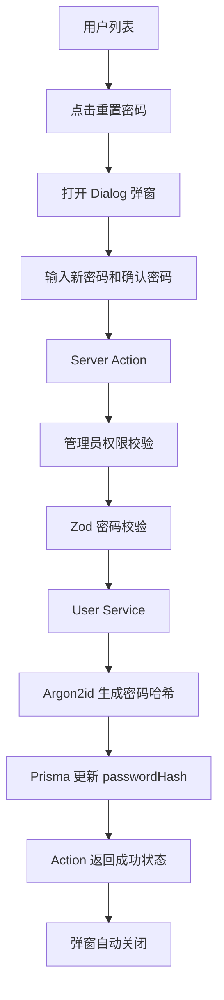

# 第七篇：实现管理员重置密码，用弹窗完成安全的密码重置

## 一、先明确本篇要实现什么

在用户管理系统中，管理员经常需要处理用户忘记密码、初始密码遗失等问题。

这次我们实现一个管理员重置密码功能：

1. 管理员在用户列表中点击“重置密码”。
2. 页面弹出对话框，不跳转新页面。
3. 输入新密码和确认密码。
4. 点击确认后，服务端校验密码。
5. 使用 Argon2id 对新密码进行哈希。
6. 更新数据库中的 `passwordHash`。
7. 重置成功后弹窗自动关闭，不刷新列表。

这里有一个明确的设计原则：

**管理员重置密码，不需要知道用户的原始密码。**

原始密码验证属于用户主动修改密码的场景。管理员重置密码属于后台管理操作，两者的业务流程不同。

本篇只实现管理员重置密码，不实现用户个人中心中的修改密码功能。

## 二、梳理实现结构

继续沿用现有的用户模块目录：

```text
features/users/
├── actions.ts
├── schemas.ts
├── service.ts
├── service.test.ts
├── schemas.test.ts
└── components/
    ├── user-list.tsx
    └── user-reset-password-dialog.tsx
```

本篇新增一个组件：

`user-reset-password-dialog.tsx`

它负责弹窗展示、表单输入和提交状态。

其他文件的职责保持不变：

| 文件 | 本篇需要做什么 |
|---|---|
| `schemas.ts` | 定义重置密码校验规则 |
| `service.ts` | 生成密码哈希、更新数据库 |
| `actions.ts` | 管理员权限校验、接收表单、调用 Service |
| `user-reset-password-dialog.tsx` | 弹窗和密码表单 |
| `user-list.tsx` | 在操作区域增加重置密码入口 |
| `service.test.ts` | 测试密码重置服务 |
| `schemas.test.ts` | 测试密码校验规则 |

整体调用关系：



## 三、添加 Dialog 对话框组件

本篇需要 Dialog 组件。当前仓库使用基于 Base UI 的 shadcn/ui，执行：

```bash
pnpm dlx shadcn@latest add dialog
```

这会在 `components/ui/` 下生成 `dialog.tsx`。如果项目中已经有这个文件，可以跳过这一步。

shadcn/ui 的 Dialog 由多个部分组合而成：

- `Dialog`：对话框根组件。
- `DialogTrigger`：触发按钮。
- `DialogContent`：对话框主体。
- `DialogHeader`：标题区域。
- `DialogTitle`：标题。
- `DialogDescription`：描述。
- `DialogFooter`：底部操作区域。
- `DialogClose`：关闭按钮。

注意：当前项目使用 Base UI 版本的 shadcn/ui，触发器采用 `render` 属性组合按钮，而不是 Radix 版本的 `asChild`。

文中的 Dialog 写法以本项目的 `components/ui/dialog.tsx` 为准。如果你生成的组件版本不同，请打开文件确认实际的 `DialogTrigger`、`DialogClose` 和 `DialogContent` API。

官方文档：[shadcn/ui Dialog](https://ui.shadcn.com/docs/components/base/dialog)

## 四、定义密码重置校验规则

打开：

`features/users/schemas.ts`

新增一个密码重置 Schema。

这里需要校验两个字段：

- `password`：新密码。
- `confirmPassword`：确认新密码。

为什么需要确认密码？

密码输入框默认会隐藏字符，如果用户输入错误，很容易造成无法登录。通过两次输入进行比对，可以减少这类问题。

在文件中增加：

```ts
export const resetPasswordSchema = z
  .object({
    password: z
      .string()
      .min(8, "密码至少 8 位")
      .max(128, "密码不能超过 128 位"),

    confirmPassword: z.string(),
  })
  .refine((data) => data.password === data.confirmPassword, {
    path: ["confirmPassword"],
    message: "两次输入的密码不一致",
  });

export type ResetPasswordInput = z.infer<
  typeof resetPasswordSchema
>;

export type ResetPasswordState = {
  success?: boolean;
  message?: string;
  fieldErrors?: {
    password?: string[];
    confirmPassword?: string[];
  };
};
```

这里使用 Zod 的 `refine` 实现跨字段校验。

`refine` 适合这种基于整个对象数据的一次性判断，Zod 4 也更推荐用它；`superRefine` 则更适合需要在同一个回调中追加多条 issue 的复杂场景。本例只有“两次密码是否一致”一条规则，用 `refine` 更直接。

注意，`confirmPassword` 只用于校验，不需要保存到数据库。

`ResetPasswordState` 中的 `success` 用于告诉弹窗这次重置是否成功，弹窗根据它决定是否关闭。它不是表单字段，也不会写入数据库。

另外，校验失败后密码输入框不会被回填。这是有意为之：不要把用户刚输入的明文密码重新塞回组件状态，用户重新输入即可。

## 五、实现密码重置 Service

打开：

`features/users/service.ts`

现有 Service 已经实现了 `createUser` 和 `updateUser`，并且通过：

```ts
import { hashPassword } from "@/lib/password";
```

调用统一的密码哈希方法。

我们不需要重新实现 Argon2，也不应该在不同业务中重复编写密码加密逻辑。

直接复用 `hashPassword`。

新增方法：

```ts
export async function resetUserPassword(
  id: string,
  password: string
) {
  const passwordHash = await hashPassword(password);

  try {
    await db.user.update({
      where: { id },
      data: {
        passwordHash,
      },
      select: {
        id: true,
      },
    });

    return {
      success: true as const,
    };
  } catch (error) {
    const code =
      typeof error === "object" &&
      error !== null &&
      "code" in error
        ? error.code
        : undefined;

    if (code === "P2025") {
      return {
        success: false as const,
        code: "NOT_FOUND" as const,
        message: "用户不存在或已被删除",
      };
    }

    throw error;
  }
}
```

这段代码主要完成三个工作。

**第一，生成密码哈希。**

```ts
const passwordHash = await hashPassword(password);
```

当前项目的 `lib/password.ts` 使用 Argon2id：

```ts
export async function hashPassword(password: string) {
  return argon2.hash(password, {
    type: argon2.argon2id,
    memoryCost: 19456,
    timeCost: 2,
    parallelism: 1,
  });
}
```

每次生成的哈希都包含算法参数和随机盐值。数据库保存的是哈希结果，而不是用户输入的明文密码。

`argon2` 是带原生模块的依赖。如果安装时 pnpm 提示 `Ignored build scripts: argon2`，执行 `pnpm approve-builds` 放行构建脚本，否则运行时会找不到 `argon2.node`。具体说明见第五篇。

**第二，只更新密码字段。**

```ts
data: {
  passwordHash,
}
```

不要把用户名、手机号、状态等字段一起提交。

密码重置只应该影响密码，不应该意外覆盖用户其他资料。

**第三，处理用户不存在的情况。**

Prisma 更新记录时，如果指定的用户 ID 不存在，会抛出 `P2025`。

我们将这个异常转换成明确的业务结果，让 Action 能够向用户反馈，而不是把普通业务情况当成服务器故障。

其他数据库异常继续抛出，不能把所有错误都吞掉。

## 六、实现 Server Action

打开：

`features/users/actions.ts`

现有文件已经有 `createUserAction` 和 `updateUserAction`。

本篇是在原文件中增加方法，不要覆盖已有代码。

首先在 Service 导入中增加 `resetUserPassword`：

```ts
import {
  createUser,
  updateUser,
  resetUserPassword,
} from "./service";
```

在 Schema 导入中增加：

```ts
import {
  createUserSchema,
  updateUserSchema,
  resetPasswordSchema,
  toFieldErrors,
  type CreateUserState,
  type UpdateUserState,
  type ResetPasswordState,
} from "./schemas";
```

然后新增 Action：

```ts
export async function resetUserPasswordAction(
  id: string,
  _prevState: ResetPasswordState,
  formData: FormData
): Promise<ResetPasswordState> {
  // 1. 管理员权限校验
  await requireUserAdmin();

  // 2. 获取表单数据
  const values = {
    password: String(formData.get("password") ?? ""),
    confirmPassword: String(
      formData.get("confirmPassword") ?? ""
    ),
  };

  // 3. Zod 校验
  const parsed = resetPasswordSchema.safeParse(values);

  if (!parsed.success) {
    return {
      message: "请检查密码输入",
      fieldErrors: toFieldErrors(parsed.error),
    };
  }

  // 4. 调用 Service
  const result = await resetUserPassword(
    id,
    parsed.data.password
  );

  if (!result.success) {
    return {
      message: result.message,
    };
  }

  // 5. 返回成功状态，由弹窗自行关闭
  return {
    success: true,
    message: "密码已重置",
  };
}
```

这里有几个值得注意的地方。

### 1. 必须先进行权限校验

```ts
await requireUserAdmin();
```

不能因为前端只给管理员显示按钮，就认为普通用户无法调用这个操作。

Server Action 是服务端入口，任何权限控制都必须在服务端执行。

特别说明：当前仓库的 `requireUserAdmin()` 仍然是开发环境守卫，非开发环境会直接拒绝操作。它还不是真正的登录身份认证和管理员角色授权。

因此，在接入正式认证系统之前，不能将这套功能直接作为生产环境的管理员权限体系。

### 2. 不接收原始密码

整个 Action 只有：

```ts
password
confirmPassword
```

没有 `oldPassword`。

管理员重置密码不需要原始密码，这也是它与用户自主修改密码的核心区别。

### 3. 不在 Action 中直接操作数据库

Action 只负责权限校验、参数校验、业务流程协调。

真正的密码哈希和数据库更新仍然由 Service 完成。

### 4. 成功后返回状态，不做跳转和列表刷新

`resetUserPasswordAction` 最后返回：

```ts
return {
  success: true,
  message: "密码已重置",
};
```

重置密码发生在弹窗里，用户本来就在 `/admin/users`。如果这里使用：

```ts
redirect("/admin/users?passwordReset=1");
```

只是给当前地址增加一个查询参数，页面不会被卸载，每一行中的 Dialog 仍然是原来的组件实例。非受控 Dialog 自己保存着“打开”状态，结果就是弹窗仍然开着，而列表后面出现了成功提示。

因此这里不调用 `redirect()`，也不调用 `revalidatePath()`：

- 弹窗需要留在当前页面，由 `ResetPasswordState.success` 通知它关闭。
- 用户列表只展示用户名、手机号、状态和创建时间，不展示密码，没有需要刷新的数据。

`redirect()` 本身没有问题，新增和编辑用户仍然使用它。它适合确实需要离开当前页面的场景，并且不要放进一个会捕获所有异常的 `try/catch` 中。

另外，`revalidatePath` 和 `redirect` 的导入仍然被其他 Action 使用，不要因为这次改动把导入删掉。

## 七、实现重置密码弹窗

新增文件：

`features/users/components/user-reset-password-dialog.tsx`

完整代码：

```tsx
"use client";

import {
  useActionState,
  useCallback,
  useEffect,
  useState,
} from "react";

import { Button } from "@/components/ui/button";
import { Input } from "@/components/ui/input";
import { Label } from "@/components/ui/label";

import {
  Dialog,
  DialogClose,
  DialogContent,
  DialogDescription,
  DialogFooter,
  DialogHeader,
  DialogTitle,
  DialogTrigger,
} from "@/components/ui/dialog";

import { resetUserPasswordAction } from "../actions";
import type { ResetPasswordState } from "../schemas";

type UserResetPasswordDialogProps = {
  userId: string;
  username: string;
};

type ResetPasswordFormProps = {
  userId: string;
  onDone: () => void;
};

const initialState: ResetPasswordState = {};

function ResetPasswordForm({
  userId,
  onDone,
}: ResetPasswordFormProps) {
  const actionWithId = resetUserPasswordAction.bind(
    null,
    userId
  );

  const [state, action, pending] = useActionState(
    actionWithId,
    initialState
  );

  const passwordError = state.fieldErrors?.password?.[0];

  const confirmPasswordError =
    state.fieldErrors?.confirmPassword?.[0];

  useEffect(() => {
    if (state.success) {
      onDone();
    }
  }, [state.success, onDone]);

  return (
    <form action={action} className="space-y-4">
      <div className="space-y-2">
        <Label htmlFor={`password-${userId}`}>
          新密码
        </Label>

        <Input
          id={`password-${userId}`}
          name="password"
          type="password"
          autoComplete="new-password"
          placeholder="请输入新密码，至少 8 位"
          aria-invalid={!!passwordError}
          aria-describedby={
            passwordError
              ? `password-error-${userId}`
              : undefined
          }
          required
        />

        {passwordError && (
          <p
            id={`password-error-${userId}`}
            className="text-sm text-destructive"
          >
            {passwordError}
          </p>
        )}
      </div>

      <div className="space-y-2">
        <Label htmlFor={`confirmPassword-${userId}`}>
          确认新密码
        </Label>

        <Input
          id={`confirmPassword-${userId}`}
          name="confirmPassword"
          type="password"
          autoComplete="new-password"
          placeholder="请再次输入新密码"
          aria-invalid={!!confirmPasswordError}
          aria-describedby={
            confirmPasswordError
              ? `confirm-password-error-${userId}`
              : undefined
          }
          required
        />

        {confirmPasswordError && (
          <p
            id={`confirm-password-error-${userId}`}
            className="text-sm text-destructive"
          >
            {confirmPasswordError}
          </p>
        )}
      </div>

      {state.message && !state.success && (
        <p role="alert" className="text-sm text-destructive">
          {state.message}
        </p>
      )}

      <DialogFooter>
        <DialogClose
          render={<Button type="button" variant="outline" />}
        >
          取消
        </DialogClose>

        <Button type="submit" disabled={pending}>
          {pending ? "正在重置..." : "确认重置"}
        </Button>
      </DialogFooter>
    </form>
  );
}

export function UserResetPasswordDialog({
  userId,
  username,
}: UserResetPasswordDialogProps) {
  const [open, setOpen] = useState(false);

  const close = useCallback(() => setOpen(false), []);

  return (
    <Dialog open={open} onOpenChange={setOpen}>
      <DialogTrigger
        render={<Button variant="outline" size="sm" />}
      >
        重置密码
      </DialogTrigger>

      <DialogContent>
        <DialogHeader>
          <DialogTitle>重置用户密码</DialogTitle>

          <DialogDescription>
            正在为用户 {username} 重置密码。
            无需输入原密码，请设置新的登录密码。
          </DialogDescription>
        </DialogHeader>

        <ResetPasswordForm userId={userId} onDone={close} />
      </DialogContent>
    </Dialog>
  );
}
```

### 这段代码的几个关键点

**1. 为什么 Dialog 需要受控？**

```tsx
const [open, setOpen] = useState(false);
```

把 Dialog 的打开状态交给 React 管理后，重置成功时可以直接 `setOpen(false)` 关闭弹窗，不需要通过跳转页面来“顺带”关闭它。

**2. 为什么表单要拆成内部组件？**

`useActionState` 的状态保存在 `ResetPasswordForm` 中，而它位于 `DialogContent` 内部。本项目使用的 Base UI Dialog 在关闭时会卸载弹窗内容，因此下一次打开会重新创建表单实例，上一次的输入和错误提示自然被清空。

如果直接把 `useActionState` 写在弹窗最外层组件，这个组件会在整个列表生命周期内一直存在。用户输入错误、关闭弹窗、再次打开时，旧的错误提示仍然会显示。

**3. 成功后如何自动关闭？**

```tsx
useEffect(() => {
  if (state.success) {
    onDone();
  }
}, [state.success, onDone]);
```

Server Action 返回 `success: true` 后，`onDone` 调用外层的 `setOpen(false)`。取消按钮则通过 `DialogClose` 关闭弹窗，不会触发提交。

**4. 为什么要绑定用户 ID？**

```tsx
const actionWithId = resetUserPasswordAction.bind(
  null,
  userId
);
```

用户列表中每一行对应一个用户，点击哪一行的重置按钮，就应该重置哪一个用户的密码。

通过 `bind` 将用户 ID 绑定到 Action，避免把用户 ID 当成普通表单字段处理。

但需要注意：绑定 ID 不代表权限安全。服务端仍然需要进行管理员身份校验。

**5. 为什么只把 `userId` 和 `username` 传给客户端组件？**

弹窗只需要知道“重置谁”和“给用户展示谁”。如果把整行用户对象传进来，`phone`、`status`、`createdAt` 等字段都会被序列化并发送到浏览器，既增加传输体积，也让无关数据暴露在客户端。

只传必要字段，和列表查询只 `select` 必要字段是同一个原则。

**6. 为什么需要两个密码输入框？**

确认密码是为了避免输入错误。

真正提交给 Service 的只有：

```ts
parsed.data.password
```

确认密码不会进入数据库。

校验失败时密码框会被清空，不会回填刚才的输入。这是有意为之：避免明文密码长期停留在组件状态中。

## 八、在用户列表中增加重置密码按钮

打开：

`features/users/components/user-list.tsx`

首先导入组件：

```tsx
import { UserResetPasswordDialog } from "./user-reset-password-dialog";
```

然后找到现有的用户操作列。

当前列表中已经有编辑按钮：

```tsx
<TableCell className="text-right">
  <Link
    href={`/admin/users/${user.id}/edit`}
    className={buttonVariants({
      variant: "outline",
      size: "sm",
    })}
  >
    编辑
  </Link>
</TableCell>
```

将它调整为：

```tsx
<TableCell className="text-right">
  <div className="flex justify-end gap-2">
    <Link
      href={`/admin/users/${user.id}/edit`}
      className={buttonVariants({
        variant: "outline",
        size: "sm",
      })}
    >
      编辑
    </Link>

    <UserResetPasswordDialog
      userId={user.id}
      username={user.username}
    />
  </div>
</TableCell>
```

这样，每一行用户就拥有两个操作：

- 编辑：跳转到用户编辑页面。
- 重置密码：打开密码重置弹窗。

注意，当前用户列表的 `getUserList` 已经查询了 `id` 和 `username`，不需要增加数据库查询字段。

如果后续按第八篇、第九篇把操作收进“更多”菜单，需要注意：不要把弹窗直接嵌在 `DropdownMenuContent` 里。下拉菜单会接管焦点并维护焦点守卫，嵌入其中的 Dialog 输入框可能无法接收键盘输入。正确做法是把弹窗提升到菜单外层，用菜单项控制 `open`，并隐藏弹窗自带的触发器。

## 九、编写测试

功能开发完成后，还需要验证三个关键环节：

1. 密码规则是否正确。
2. Service 是否把哈希结果传给数据库更新。测试中的数据库是 Mock 的，只能验证调用参数，不能证明数据真的写入了数据库。
3. 密码哈希本身是否可靠。

### 1. 测试 Schema

打开：

`features/users/schemas.test.ts`

增加：

```ts
import { resetPasswordSchema } from "./schemas";

describe("resetPasswordSchema", () => {
  it("有效密码应通过校验", () => {
    const result = resetPasswordSchema.safeParse({
      password: "Learn@2026",
      confirmPassword: "Learn@2026",
    });

    expect(result.success).toBe(true);
  });

  it("密码少于 8 位应校验失败", () => {
    const result = resetPasswordSchema.safeParse({
      password: "123456",
      confirmPassword: "123456",
    });

    expect(result.success).toBe(false);
  });

  it("两次密码不一致应校验失败", () => {
    const result = resetPasswordSchema.safeParse({
      password: "Learn@2026",
      confirmPassword: "Learn@2025",
    });

    expect(result.success).toBe(false);

    if (!result.success) {
      expect(
        result.error.issues.some(
          (issue) => issue.path[0] === "confirmPassword"
        )
      ).toBe(true);
    }
  });

  it("密码超过 128 位应校验失败", () => {
    const result = resetPasswordSchema.safeParse({
      password: "a".repeat(129),
      confirmPassword: "a".repeat(129),
    });

    expect(result.success).toBe(false);
  });
});
```

示例中的 `Learn@2026` 只是满足当前 8 位长度要求的演示密码，不代表推荐的密码强度。当前规则还没有数字、字母、符号的复杂度校验，后续可以按业务要求补充。

### 2. 测试 Service

当前 `service.test.ts` 已经使用 Vitest Mock 了数据库和密码哈希方法。

其中已经存在：

```ts
const {
  update,
  hashPassword,
} = vi.hoisted(() => ({
  update: vi.fn(),
  hashPassword: vi.fn(),
}));
```

注意保留测试文件中已有的其他 Mock 配置，不要在新增用例时覆盖掉。

在现有导入中增加：

```ts
import {
  createUser,
  getUserList,
  updateUser,
  resetUserPassword,
} from "./service";
```

新增测试：

```ts
describe("resetUserPassword", () => {
  const newPassword = "Learn@2026";

  beforeEach(() => {
    vi.clearAllMocks();

    hashPassword.mockResolvedValue("hashed-password");

    update.mockResolvedValue({
      id: "user-1",
    });
  });

  it("应使用哈希密码更新用户密码", async () => {
    const result = await resetUserPassword(
      "user-1",
      newPassword
    );

    expect(hashPassword).toHaveBeenCalledWith(newPassword);

    expect(update).toHaveBeenCalledWith({
      where: {
        id: "user-1",
      },
      data: {
        passwordHash: "hashed-password",
      },
      select: {
        id: true,
      },
    });

    expect(result).toEqual({
      success: true,
    });
  });

  it("用户不存在时应返回 NOT_FOUND", async () => {
    update.mockRejectedValue({
      code: "P2025",
    });

    const result = await resetUserPassword(
      "missing-user",
      newPassword
    );

    expect(result).toEqual({
      success: false,
      code: "NOT_FOUND",
      message: "用户不存在或已被删除",
    });
  });

  it("其他数据库异常应继续抛出", async () => {
    const error = new Error("connection lost");

    update.mockRejectedValue(error);

    await expect(
      resetUserPassword("user-1", newPassword)
    ).rejects.toBe(error);
  });

  it("传给数据库更新参数中不应出现明文密码", async () => {
    await resetUserPassword("user-1", newPassword);

    expect(JSON.stringify(update.mock.calls)).not.toContain(
      newPassword
    );
  });
});
```

这些用例验证的是 Service 传给 Prisma 的参数。真正的写库行为并没有在单元测试中覆盖，需要结合下面的手动验证一起看。

### 3. 测试密码哈希

打开：

`lib/password.test.ts`

密码哈希函数本身也需要测试：

```ts
import { describe, expect, it, vi } from "vitest";

vi.mock("server-only", () => ({}));

import { hashPassword, verifyPassword } from "./password";

describe("password", () => {
  it("每次哈希结果不同，且不包含明文", async () => {
    const password = "Learn@2026";

    const first = await hashPassword(password);
    const second = await hashPassword(password);

    expect(first).not.toBe(second);
    expect(first.startsWith("$argon2id$")).toBe(true);
    expect(first).not.toContain(password);
  });

  it("能够验证正确密码并拒绝错误密码", async () => {
    const hash = await hashPassword("Learn@2026");

    expect(await verifyPassword("Learn@2026", hash)).toBe(true);
    expect(await verifyPassword("wrong-password", hash)).toBe(
      false
    );
  });
});
```

### 4. Action 层暂未覆盖

`resetUserPasswordAction` 依赖 Next.js 的请求上下文和 `requireUserAdmin()`，直接调用需要额外的测试环境。本篇先通过手动流程验证；接入正式认证后，再补充权限失败、校验失败和 Service 失败三类分支的测试。

执行测试：

```bash
pnpm test
```

## 十、浏览器验证

测试通过后，启动项目：

```bash
pnpm dev
```

进入用户管理页面：

`/admin/users`

按照下面的流程验证：

1. 找到一个已有用户，点击“重置密码”。
2. 检查是否弹出对话框。
3. 不输入原始密码，直接输入新密码，例如 `Learn@2026`。
4. 两次输入不一致，确认弹窗保持打开并显示“两次输入的密码不一致”。
5. 关闭弹窗后重新打开，确认上一次的错误提示和输入已经清空。
6. 输入一致的新密码，点击“确认重置”。
7. 检查弹窗是否自动关闭，页面是否停留在用户列表，并且不再出现额外的成功提示。
8. 使用数据库工具对比重置前后的 `passwordHash`，确认值已经变化，并且以 `$argon2id$` 开头，不是明文。
9. 用临时脚本校验新密码与数据库中的哈希是否匹配。

第六篇已经说明，项目还没有接入登录认证，因此这里不要求“用新密码登录”。等认证功能完成后再补这一步。

验证密码哈希时，可以直接使用 `argon2`：

```bash
node -e "const argon2=require('argon2'); argon2.verify(process.argv[1], process.argv[2]).then((ok) => console.log(ok))" '<passwordHash>' 'Learn@2026'
```

第一个参数是数据库中的完整哈希，第二个参数是刚设置的新密码。在 PowerShell 中请使用单引号包裹哈希，避免 `$` 被当作变量展开。这个命令只用于临时验证，不需要提交到仓库。

重置前后哈希不同是正常现象：Argon2id 每次都会使用随机盐，即使两次输入同一个密码，哈希结果也不同。

另外可以准备一个已知原密码的测试账号，管理员重置后确认新密码匹配、原密码不再匹配，以验证整个流程确实没有使用原密码。

## 十一、本篇需要理解的几个工程问题

### 1. 重置密码与修改密码不是一回事

两者的业务边界不同：

| 对比项 | 用户修改密码 | 管理员重置密码 |
|---|---|---|
| 操作主体 | 当前登录用户 | 管理员 |
| 是否需要原密码 | 通常需要 | 不需要 |
| 是否需要管理员权限 | 不需要 | 需要 |
| 是否需要服务端校验 | 是 | 是 |

不要为了复用代码，把两种操作合并成一个没有明确权限边界的 Action。

### 2. 永远不要保存明文密码

数据库中的 `passwordHash` 只能保存哈希结果。

无论是用户注册、管理员新增用户，还是管理员重置密码，都应该统一调用 `hashPassword()`。

密码哈希不是简单的字符串加密，不能通过解密方式还原原始密码。

### 3. 前端隐藏按钮不等于权限控制

即使以后我们根据用户角色控制按钮是否显示，也不能省略服务端权限检查。

真正的安全边界在 Server Action 和 Service 的服务端执行路径上，而不是页面上的按钮。

### 4. 密码重置后，必须让旧登录状态失效

这是一个需要继续深入的安全问题。

当前项目还没有实现完整的登录认证和会话管理，因此本篇只更新密码哈希，不处理会话失效。

等后续接入认证系统后，需要增加：

- 用户密码修改时间或凭证版本号。
- 登录会话与用户关联。
- 重置密码后递增凭证版本号。
- 下次请求时校验版本号，拒绝旧会话。

否则，即使用户密码已经重置，旧的登录会话也可能仍然有效。

### 5. 管理员设置的密码，管理员自己是知道的

管理员在弹窗里输入的新密码，管理员本人可以看到。这适合“用户同意管理员代为设置”的场景，但不是最稳妥的长期方案。

更安全的做法是：管理员只生成一个临时密码，用户首次登录后强制修改。实现上可以在 User 模型中增加 `mustChangePassword` 标记，并在登录成功后检查该标记，跳转到修改密码页面。

这个能力需要数据库迁移和登录流程配合，建议在接入认证系统时一起完成。

### 6. 审计日志应该是必须项

重置别人的密码是高敏感操作，至少应该记录：

- 谁执行了重置（操作人 ID）。
- 重置了谁（目标用户 ID）。
- 什么时候执行（时间）。
- 不能记录密码本身，也不能记录密码哈希。

第二篇的数据库设计中规划了 `audit_logs` 表，但当前 Prisma Schema 还没有创建这个模型。后续接入审计日志时，需要补上模型与迁移，并把用户新增、编辑、启用、停用、删除和密码重置都记录进去。

---

## 本篇小结

本篇完成了管理员重置用户密码的完整流程：

- 使用 shadcn/ui Dialog 实现弹窗交互，并通过受控状态在成功后自动关闭。
- 使用 React 19 `useActionState` 管理提交状态。
- 使用 Zod 校验新密码和确认密码。
- 使用 Server Action 完成管理员权限校验。
- 使用 Service 统一调用 Argon2id 生成密码哈希。
- 使用 Prisma 只更新 `passwordHash`。
- 只向客户端组件传递必要的用户字段。
- 使用 Vitest 验证密码规则、哈希生成和密码重置逻辑。

到这里，用户管理模块已经具备了三个核心操作：

**新增用户、编辑用户资料、重置用户密码。**

这三个操作虽然都围绕 User 模型展开，但业务规则并不相同。把它们拆分为独立的 Schema、Action 和 Service，才能让用户管理模块保持清晰的职责边界。

下一步可以继续实现用户启用与禁用功能，让用户管理从基础资料维护，进一步具备账号生命周期管理能力。