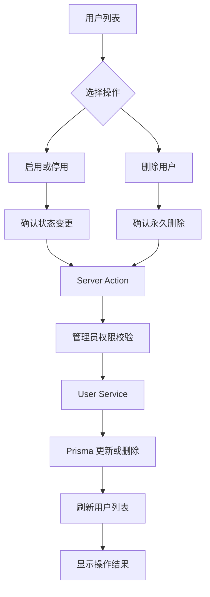

# 第八篇：实现用户启用、停用与删除，完善账号生命周期管理

## 一、本篇要实现什么？

前面几篇，我们已经完成了用户管理的基础功能：

- 用户列表与分页查询
- 新增用户
- 编辑用户资料
- 管理员重置密码

但一个完整的用户管理模块，还需要解决另外三个问题：

1. 用户暂时不允许登录，如何停用账号？
2. 用户重新获得使用权限，如何启用账号？
3. 用户不再需要，如何删除账号？

本篇就围绕这三个功能展开。

最终，我们希望在用户列表的操作列中，实现：

| 操作 | 业务含义 |
|---|---|
| 启用 | 将停用账号恢复为正常状态 |
| 停用 | 禁止账号继续使用系统 |
| 删除 | 从数据库中永久删除用户记录 |

这里先明确一个设计选择：

**启用和停用属于状态变更，删除属于数据删除，两者不是同一类操作。**

启用、停用可以反复切换，而删除是不可逆操作，因此删除必须增加二次确认。

另外，这三个操作都发生在用户列表行内。管理员可能正在搜索某个用户名，或者停留在第 3 页。操作完成后不应该跳转页面，否则搜索条件和页码都会丢失。

## 二、先看当前数据库模型

打开：

`prisma/schema.prisma`

当前 User 模型已经有状态字段：

```prisma
enum UserStatus {
  ACTIVE
  DISABLED
}

model User {
  id           String   @id @default(uuid())
  username     String   @unique
  passwordHash String
  phone        String?
  status       UserStatus @default(ACTIVE)
  createdAt    DateTime @default(now())
  updatedAt    DateTime @updatedAt
}
```

其中：

```prisma
status UserStatus @default(ACTIVE)
```

表示新建用户默认处于启用状态。

两个枚举值分别表示：

- `ACTIVE`：账号启用。
- `DISABLED`：账号停用。

因此，本篇不需要增加字段，也不需要执行数据库迁移。

### 为什么不用删除来代替停用？

因为用户是否存在，与用户是否可以使用系统，是两个不同的问题。

例如：

- 员工离职，但历史业务数据仍然需要保留。
- 合作方暂时停止合作，未来可能恢复。
- 用户违反使用规则，需要临时冻结账号。

这些场景都不应该直接删除用户。

所以，启用和停用应该通过状态字段完成。

### 本篇采用什么删除策略？

当前 User 模型还没有关联课程、订单、教学记录等业务数据，因此本篇采用物理删除：

```ts
db.user.delete({
  where: { id },
});
```

这意味着数据库记录会被真正删除。

等后续用户与课程、教师、订单等业务数据建立关联后，就需要重新评估删除策略。对于有历史业务记录的用户，通常应该采用停用或软删除，而不是直接删除。

## 三、梳理项目结构

继续沿用现有用户模块：

```text
features/users/
├── actions.ts
├── actions.test.ts
├── schemas.ts
├── service.ts
├── service.test.ts
├── constants.ts
└── components/
    ├── user-list.tsx
    ├── user-reset-password-dialog.tsx
    └── user-account-actions.tsx
```

本篇新增：

`features/users/components/user-account-actions.tsx`

它负责用户启用、停用和删除的交互。

其他文件职责：

| 文件 | 本篇改动 |
|---|---|
| `service.ts` | 增加状态更新和用户删除方法 |
| `actions.ts` | 增加启用、停用、删除 Server Action |
| `user-list.tsx` | 增加操作入口，并只向客户端组件传递必要字段 |
| `user-account-actions.tsx` | 实现确认弹窗、提交中状态和操作按钮 |
| `service.test.ts` | 测试状态更新和删除逻辑 |
| `actions.test.ts` | 测试 Action 的参数传递、非法状态和失败分支 |

整体流程：



## 四、先生成确认弹窗组件

本篇需要使用 AlertDialog。

普通 Dialog 更适合展示表单、编辑资料等交互；AlertDialog 更适合执行具有风险的操作，例如删除数据。

先添加 AlertDialog 组件：

```bash
pnpm dlx shadcn@latest add alert-dialog
```

如果项目中已经有 `components/ui/alert-dialog.tsx`，可以跳过这一步。

生成后会得到：

`components/ui/alert-dialog.tsx`

它包含：

- `AlertDialog`
- `AlertDialogTrigger`
- `AlertDialogContent`
- `AlertDialogHeader`
- `AlertDialogTitle`
- `AlertDialogDescription`
- `AlertDialogFooter`
- `AlertDialogCancel`
- `AlertDialogAction`

本篇使用它实现二次确认。

添加完成后，打开 `components/ui/alert-dialog.tsx` 确认实际 API。本项目的 AlertDialog 基于 Base UI，`AlertDialogTrigger` 和 `AlertDialogCancel` 通过 `render` 组合按钮；`AlertDialogAction` 本质上是一个普通 Button，不会在点击时自动关闭弹窗。文中的写法以实际组件文件为准。

## 五、实现 Service 层

打开：

`features/users/service.ts`

我们需要增加两个方法：

- `setUserStatus`：修改用户状态。
- `deleteUser`：删除用户。

### 1. 实现用户状态修改

先导入 UserStatus 类型：

```ts
import type { UserStatus } from "@/app/generated/prisma/client";
```

在增加新方法之前，先把错误处理统一起来。前面的 `updateUser`、`resetUserPassword` 已经各自判断一次 Prisma 错误码，如果每个新操作都再复制一遍，代码会越来越难维护。

在 `service.ts` 顶部增加共享类型和两个小工具：

```ts
export type UserOperationResult =
  | {
      success: true;
    }
  | {
      success: false;
      code: "NOT_FOUND" | "USERNAME_TAKEN" | "CONFLICT";
      message: string;
    };

function getErrorCode(error: unknown): string | undefined {
  if (typeof error === "object" && error !== null && "code" in error) {
    const code = (error as { code?: unknown }).code;

    return typeof code === "string" ? code : undefined;
  }

  return undefined;
}

const USER_NOT_FOUND = {
  success: false,
  code: "NOT_FOUND",
  message: "用户不存在或已被删除",
} as const;

const USER_HAS_RELATIONS = {
  success: false,
  code: "CONFLICT",
  message: "该用户存在关联数据，无法删除，请改为停用",
} as const;
```

`getErrorCode` 只负责读取错误码，不会吞掉未知异常；`USER_NOT_FOUND` 和 `USER_HAS_RELATIONS` 则统一了两种常见业务结果。

然后把 `updateUser` 和 `resetUserPassword` 中重复的错误判断替换为 `getErrorCode(error)` 和 `USER_NOT_FOUND`。

这样，`setUserStatus` 和 `deleteUser` 也可以直接复用同一套结果类型。

然后实现状态修改：

```ts
export async function setUserStatus(
  id: string,
  status: UserStatus
): Promise<UserOperationResult> {
  try {
    await db.user.update({
      where: { id },
      data: { status },
      select: { id: true },
    });

    return {
      success: true,
    };
  } catch (error) {
    if (getErrorCode(error) === "P2025") {
      return USER_NOT_FOUND;
    }

    throw error;
  }
}
```

这段代码非常简单。

核心就是：

```ts
data: { status }
```

管理员传入 `ACTIVE`，用户就变为启用状态；传入 `DISABLED`，用户就变为停用状态。

为什么不在这里分别写两个方法？

因为启用和停用本质上都是修改同一个字段，只是目标状态不同。

将它们统一为 `setUserStatus`，可以避免重复代码。

另外，数据库更新使用 `where: { id }`。如果用户已经被删除，Prisma 会返回 `P2025`，我们将它转换为明确的业务结果。

### 2. 实现用户删除

继续在 `service.ts` 中增加：

```ts
export async function deleteUser(
  id: string
): Promise<UserOperationResult> {
  try {
    await db.user.delete({
      where: { id },
      select: { id: true },
    });

    return {
      success: true,
    };
  } catch (error) {
    const code = getErrorCode(error);

    if (code === "P2025") {
      return USER_NOT_FOUND;
    }

    if (code === "P2003") {
      return USER_HAS_RELATIONS;
    }

    throw error;
  }
}
```

这里与状态修改的区别是：

```ts
db.user.delete()
```

这是真正删除数据库记录。

需要特别注意：如果以后 User 与其他业务表建立了外键关系，删除操作会触发 Prisma 的关联约束错误 `P2003`。

这里不能把 `P2003` 当成 500 错误直接抛给用户，也不能为了删除成功就随意级联删除关联数据。当前的处理是把它转换为明确的业务结果：

```text
该用户存在关联数据，无法删除，请改为停用
```

对于用户历史数据，应该优先考虑保留记录，而不是为了删除账号把业务数据一并清除。

等后续真正建立外键关系时，还要为这个分支补充数据库层面的测试或集成验证，确认 Prisma 实际抛出的错误码与预期一致。

## 六、实现 Server Actions

打开：

`features/users/actions.ts`

现有文件已经包含：

- `createUserAction`
- `updateUserAction`
- `resetUserPasswordAction`

本篇继续增加两个 Action。

先增加 UserStatus 类型和 Service 导入：

```ts
import type { UserStatus } from "@/app/generated/prisma/client";

import {
  createUser,
  updateUser,
  resetUserPassword,
  setUserStatus,
  deleteUser,
} from "./service";
```

再定义一个 Action 返回类型：

```ts
export type UserActionResult = {
  success: boolean;
  message?: string;
};
```

### 1. 用户启用和停用 Action

增加：

```ts
export async function setUserStatusAction(
  id: string,
  status: UserStatus
): Promise<UserActionResult> {
  await requireUserAdmin();

  if (status !== "ACTIVE" && status !== "DISABLED") {
    return {
      success: false,
      message: "无效的用户状态",
    };
  }

  const result = await setUserStatus(id, status);

  revalidatePath("/admin/users");

  return result.success
    ? { success: true }
    : { success: false, message: result.message };
}
```

### 2. 用户删除 Action

继续增加：

```ts
export async function deleteUserAction(
  id: string
): Promise<UserActionResult> {
  await requireUserAdmin();

  const result = await deleteUser(id);

  revalidatePath("/admin/users");

  return result.success
    ? { success: true }
    : { success: false, message: result.message };
}
```

删除 Action 不需要接收表单字段，因为删除操作只需要用户 ID。

注意：这里的 ID 仍然只是定位目标记录的参数，不代表调用者有权删除该用户。真正的权限检查必须在服务端完成。

### 为什么行内操作不跳转页面？

启用、停用和删除都是行内操作，用户本来就在列表页。

如果 Action 成功后执行：

```ts
redirect("/admin/users?statusChanged=1");
```

管理员在搜索 `demo` 的第 3 页点击“停用”，就会被带回没有搜索条件的第 1 页，每次操作都要重新查找。

因此这里只调用：

```ts
revalidatePath("/admin/users");
```

当前路由会重新获取数据，但 URL 中的搜索条件、页码和排序都不会丢失。

无论成功还是失败都要刷新：如果用户已经被其他人删除，操作会返回“用户不存在”，此时列表也应该更新。

### 为什么返回结果，而不是继续使用查询参数？

如果依赖 `statusChanged=1`、`deleted=1`、`error=user-not-found` 这些参数，URL 会越来越长，而且成功提示只能在整页刷新后出现。

改成返回 `UserActionResult` 后，由客户端组件根据结果决定提示内容：

- 成功：显示“账号已停用”“用户已删除”。
- 失败：显示 Service 返回的具体原因。

页面地址保持不变，也不需要新增更多查询参数。

### 为什么“无效状态”返回失败结果，而不是抛出异常？

抛出异常会变成 500 错误，用户只能看到一个笼统的失败页面。这里返回：

```ts
{
  success: false,
  message: "无效的用户状态",
}
```

客户端可以把它当作普通业务错误提示出来，服务端日志里也不会出现大量无意义的异常堆栈。

另外，`revalidatePath` 和 `redirect` 的导入仍然被新增、编辑用户等 Action 使用，不要因为这次改动把导入删掉。

## 七、实现用户操作组件

新增：

`features/users/components/user-account-actions.tsx`

这个组件负责两个部分：

1. 根据当前状态显示启用或停用按钮。
2. 点击删除后弹出二次确认框。

完整代码：

```tsx
"use client";

import { useState, useTransition } from "react";

import type { UserStatus } from "@/app/generated/prisma/client";
import { toast } from "sonner";

import {
  AlertDialog,
  AlertDialogAction,
  AlertDialogCancel,
  AlertDialogContent,
  AlertDialogDescription,
  AlertDialogFooter,
  AlertDialogHeader,
  AlertDialogTitle,
  AlertDialogTrigger,
} from "@/components/ui/alert-dialog";
import { Button } from "@/components/ui/button";

import { setUserStatusAction, deleteUserAction } from "../actions";

type UserAccountActionsProps = {
  userId: string;
  username: string;
  status: UserStatus;
};

export function UserAccountActions({
  userId,
  username,
  status,
}: UserAccountActionsProps) {
  const isActive = status === "ACTIVE";

  const nextStatus: UserStatus = isActive
    ? "DISABLED"
    : "ACTIVE";

  const [deleteOpen, setDeleteOpen] = useState(false);

  const [statusPending, startStatusTransition] =
    useTransition();

  const [deletePending, startDeleteTransition] =
    useTransition();

  function handleStatusChange() {
    startStatusTransition(async () => {
      const result = await setUserStatusAction(
        userId,
        nextStatus
      );

      if (result.success) {
        toast.success(
          isActive ? "账号已停用" : "账号已启用"
        );
      } else {
        toast.error(result.message ?? "操作失败");
      }
    });
  }

  function handleDelete() {
    startDeleteTransition(async () => {
      const result = await deleteUserAction(userId);

      if (result.success) {
        setDeleteOpen(false);
        toast.success("用户已删除");
      } else {
        toast.error(result.message ?? "删除失败");
      }
    });
  }

  return (
    <div className="flex justify-end gap-2">
      <Button
        type="button"
        size="sm"
        variant="outline"
        onClick={handleStatusChange}
        disabled={statusPending}
      >
        {statusPending
          ? "处理中..."
          : isActive
            ? "停用"
            : "启用"}
      </Button>

      <AlertDialog
        open={deleteOpen}
        onOpenChange={setDeleteOpen}
      >
        <AlertDialogTrigger
          render={
            <Button size="sm" variant="destructive" />
          }
        >
          删除
        </AlertDialogTrigger>

        <AlertDialogContent>
          <AlertDialogHeader>
            <AlertDialogTitle>
              确认删除用户？
            </AlertDialogTitle>

            <AlertDialogDescription>
              即将永久删除用户「{username}」，该用户名会同时被释放。
              删除后无法恢复，请确认该用户没有需要保留的业务数据。
            </AlertDialogDescription>
          </AlertDialogHeader>

          <AlertDialogFooter>
            <AlertDialogCancel disabled={deletePending}>
              取消
            </AlertDialogCancel>

            <AlertDialogAction
              variant="destructive"
              onClick={handleDelete}
              disabled={deletePending}
            >
              {deletePending ? "正在删除..." : "确认删除"}
            </AlertDialogAction>
          </AlertDialogFooter>
        </AlertDialogContent>
      </AlertDialog>
    </div>
  );
}
```

这里使用了 `sonner` 的 `toast` 显示操作结果。安装和 `Toaster` 配置见第九节；如果暂时跳过第九节，可以先把 `toast` 相关调用注释掉。

### 为什么启用和停用不需要确认弹窗？

启用和停用是可逆操作，可以直接点击完成。

删除则不同，一旦删除就可能丢失数据，因此必须增加确认步骤。

如果未来系统的账号停用会触发复杂后果，例如终止正在进行的业务流程，也可以为停用增加确认弹窗。

### 为什么用 useTransition，而不是把 Action 直接交给 form？

```tsx
const [statusPending, startStatusTransition] =
  useTransition();
```

把 Server Action 直接写成 `<form action={...}>` 也能工作，但有两个问题：

- 无法方便地在提交期间禁用按钮，用户连续点击会发起多次请求。
- Action 返回的结果不会自动出现在当前组件中，很难在行内或轻提示里展示。

使用 `useTransition` 后，可以直接调用 Action、等待结果，并在 `pending` 期间禁用按钮：

```tsx
disabled={statusPending}
```

删除操作同理，避免用户连续点击“确认删除”。

### 为什么删除弹窗要受控？

```tsx
<AlertDialog
  open={deleteOpen}
  onOpenChange={setDeleteOpen}
>
```

删除成功后需要由代码主动关闭弹窗：

```tsx
if (result.success) {
  setDeleteOpen(false);
}
```

如果删除失败，弹窗保持打开，用户可以看到错误提示并决定是否重试。

另外，`AlertDialogAction` 在本项目的组件实现中是一个普通 `Button`，不会在点击时自动关闭弹窗。因此把 `onClick={handleDelete}` 放在它上面可以正常工作；如果需要，也可以直接给它传 `variant="destructive"`。

### 为什么删除操作要再次确认？

删除是破坏性操作。

确认弹窗不是为了增加操作步骤，而是让管理员明确知道自己正在删除哪一个用户。文案中同时写明“用户名会被释放”，避免管理员误以为只是隐藏账号。

## 八、改造用户列表

打开：

`features/users/components/user-list.tsx`

首先导入：

```tsx
import { UserAccountActions } from "./user-account-actions";
```

当前列表已经有编辑和重置密码按钮。

找到操作列：

```tsx
<TableCell className="text-right">
  <div className="flex justify-end gap-2">
    <Link
      href={`/admin/users/${user.id}/edit`}
      className={buttonVariants({
        variant: "outline",
        size: "sm",
      })}
    >
      编辑
    </Link>

    <UserResetPasswordDialog
      userId={user.id}
      username={user.username}
    />
  </div>
</TableCell>
```

将它替换为：

```tsx
<TableCell className="text-right">
  <div className="flex flex-wrap justify-end gap-2">
    <Link
      href={`/admin/users/${user.id}/edit`}
      className={buttonVariants({
        variant: "outline",
        size: "sm",
      })}
    >
      编辑
    </Link>

    <UserResetPasswordDialog
      userId={user.id}
      username={user.username}
    />

    <UserAccountActions
      userId={user.id}
      username={user.username}
      status={user.status}
    />
  </div>
</TableCell>
```

这样，每个用户都拥有完整的操作入口：

- 编辑
- 重置密码
- 启用或停用
- 删除

这里只传 `userId`、`username` 和 `status` 三个字段，而不是把整行 `user` 对象传进客户端组件。

如果传整个对象，`phone`、`createdAt` 等字段也会被序列化并发送到浏览器。客户端组件用不到这些数据，既增加传输体积，也让无关数据暴露在客户端。

如果需要复用的状态类型，直接导入：

```tsx
import type { UserStatus } from "@/app/generated/prisma/client";
```

不要手动重复写 `"ACTIVE" | "DISABLED"`。

注意，当前 `getUserList` 已经查询了 `status` 字段，所以不需要增加数据库查询字段。

## 九、增加操作结果提示

操作结果已经由 `UserActionResult` 返回，客户端组件只需要把结果转换成提示。

本篇使用 `sonner` 显示轻提示。先安装：

```bash
pnpm add sonner
```

然后在根布局挂载一次 `Toaster`：

`app/layout.tsx`

```tsx
import { Toaster } from "sonner";

export default function RootLayout({
  children,
}: Readonly<{
  children: React.ReactNode;
}>) {
  return (
    <html lang="zh-CN">
      <body>
        {children}
        <Toaster position="top-center" richColors />
      </body>
    </html>
  );
}
```

不需要在每个页面单独放 `Toaster`，整个应用有一个就够了。

用户操作组件中：

```tsx
if (result.success) {
  toast.success("账号已停用");
} else {
  toast.error(result.message ?? "操作失败");
}
```

这样，操作成功和失败都有明确反馈，而且：

- 不需要跳转页面。
- 不需要 `statusChanged`、`deleted`、`error` 这些查询参数。
- 搜索条件、页码和当前滚动位置都可以保留。
- 管理员连续操作多个用户时，不需要反复重新查找。

`user-list.tsx` 里原来用于显示成功或失败的三个提示块，可以一并删除。

## 十、完善 Service 测试

打开：

`features/users/service.test.ts`

当前测试文件已经 Mock 了：

```ts
const {
  findMany,
  count,
  create,
  update,
  findUnique,
  hashPassword,
} = vi.hoisted(() => ({
  findMany: vi.fn(),
  count: vi.fn(),
  create: vi.fn(),
  update: vi.fn(),
  findUnique: vi.fn(),
  hashPassword: vi.fn(),
}));
```

本篇只需要再增加一个 `delete` Mock。

调整为：

```ts
const {
  findMany,
  count,
  create,
  update,
  findUnique,
  deleteUserMock,
  hashPassword,
} = vi.hoisted(() => ({
  findMany: vi.fn(),
  count: vi.fn(),
  create: vi.fn(),
  update: vi.fn(),
  findUnique: vi.fn(),
  deleteUserMock: vi.fn(),
  hashPassword: vi.fn(),
}));
```

同时调整数据库 Mock：

```ts
vi.mock("@/lib/db", () => ({
  db: {
    user: {
      findMany,
      count,
      create,
      update,
      findUnique,
      delete: deleteUserMock,
    },
  },
}));
```

在 Service 导入中增加：

```ts
import {
  createUser,
  getUserById,
  getUserList,
  resetUserPassword,
  updateUser,
  setUserStatus,
  deleteUser,
} from "./service";
```

### 1. 测试用户状态修改

增加：

```ts
describe("setUserStatus", () => {
  beforeEach(() => {
    vi.clearAllMocks();

    update.mockResolvedValue({
      id: "user-1",
    });
  });

  it.each(["ACTIVE", "DISABLED"] as const)(
    "应将用户状态修改为 %s",
    async (status) => {
      const result = await setUserStatus("user-1", status);

      expect(update).toHaveBeenCalledWith({
        where: {
          id: "user-1",
        },
        data: {
          status,
        },
        select: {
          id: true,
        },
      });

      expect(result).toEqual({
        success: true,
      });
    }
  );

  it("用户不存在时应返回 NOT_FOUND", async () => {
    update.mockRejectedValue({
      code: "P2025",
    });

    const result = await setUserStatus(
      "missing-user",
      "DISABLED"
    );

    expect(result).toEqual({
      success: false,
      code: "NOT_FOUND",
      message: "用户不存在或已被删除",
    });
  });

  it("其他数据库异常应继续抛出", async () => {
    const error = new Error("connection lost");

    update.mockRejectedValue(error);

    await expect(
      setUserStatus("user-1", "DISABLED")
    ).rejects.toBe(error);
  });
});
```

### 2. 测试用户删除

增加：

```ts
describe("deleteUser", () => {
  beforeEach(() => {
    vi.clearAllMocks();

    deleteUserMock.mockResolvedValue({
      id: "user-1",
    });
  });

  it("应调用删除并返回成功", async () => {
    const result = await deleteUser("user-1");

    expect(deleteUserMock).toHaveBeenCalledWith({
      where: {
        id: "user-1",
      },
      select: {
        id: true,
      },
    });

    expect(result).toEqual({
      success: true,
    });
  });

  it("用户不存在时应返回 NOT_FOUND", async () => {
    deleteUserMock.mockRejectedValue({
      code: "P2025",
    });

    const result = await deleteUser("missing-user");

    expect(result).toEqual({
      success: false,
      code: "NOT_FOUND",
      message: "用户不存在或已被删除",
    });
  });

  it("存在关联数据时应返回 CONFLICT", async () => {
    deleteUserMock.mockRejectedValue({
      code: "P2003",
    });

    const result = await deleteUser("user-1");

    expect(result).toEqual({
      success: false,
      code: "CONFLICT",
      message: "该用户存在关联数据，无法删除，请改为停用",
    });
  });

  it("其他数据库异常应继续抛出", async () => {
    const error = new Error("connection lost");

    deleteUserMock.mockRejectedValue(error);

    await expect(
      deleteUser("user-1")
    ).rejects.toBe(error);
  });
});
```

运行测试：

```bash
pnpm test
```

这里需要注意，`deleteUserMock` 只是测试文件中的 Mock 函数名称，真正的数据库方法仍然是 `db.user.delete()`。

这些用例里的数据库都是 Mock 的，验证的是「Service 是否用正确的参数调用了 Prisma」，以及「拿到特定错误码后是否返回了正确的业务结果」，并没有真正写入数据库。所以用例名称写的是「应调用删除并返回成功」，而不是「验证删除成功」。

### 3. 补充 Action 层测试

Service 之外，Action 层也需要测试，尤其是新增的「无效状态」分支。新增：

`features/users/actions.test.ts`

Action 依赖权限守卫和 Next.js 的缓存函数，测试中先把它们 Mock 掉：

```ts
const { requireUserAdmin, revalidatePath, setUserStatus, deleteUser } =
  vi.hoisted(() => ({
    requireUserAdmin: vi.fn(),
    revalidatePath: vi.fn(),
    setUserStatus: vi.fn(),
    deleteUser: vi.fn(),
  }));

vi.mock("@/lib/auth-guard", () => ({ requireUserAdmin }));
vi.mock("next/cache", () => ({ revalidatePath }));
vi.mock("next/navigation", () => ({ redirect: vi.fn() }));
vi.mock("./service", () => ({
  createUser: vi.fn(),
  updateUser: vi.fn(),
  resetUserPassword: vi.fn(),
  setUserStatus,
  deleteUser,
}));
```

需要覆盖的分支：

- 正常调用：传给 Service 的参数正确，并调用了 `revalidatePath("/admin/users")`。
- 非法状态：不调用 Service，直接返回失败结果。
- Service 返回失败：把 `message` 传给调用方，同时仍然刷新列表。
- 非管理员：`requireUserAdmin` 抛错时，Action 不应继续调用 Service。

「非法状态」的用例：

```ts
it("非法状态应直接返回失败结果，不调用 Service", async () => {
  const result = await setUserStatusAction(
    "user-1",
    "UNKNOWN" as never
  );

  expect(setUserStatus).not.toHaveBeenCalled();

  expect(result).toEqual({
    success: false,
    message: "无效的用户状态",
  });
});
```

这些测试同样只验证 Action 的调用行为和返回值，不会真正写入数据库。注意在每个 `beforeEach` 中重新设置：

```ts
requireUserAdmin.mockResolvedValue(undefined);
```

否则上一个用例里的 `mockRejectedValue` 会残留到后续用例，导致后续用例全部被拒绝。

## 十一、浏览器验证

启动项目：

```bash
pnpm dev
```

打开：

`/admin/users`

依次验证：

### 测试一：停用用户

1. 在搜索框中输入 `demo`，点击搜索，停留在有搜索结果的页面。
2. 找到一个启用状态的用户，点击「停用」。
3. 页面不应跳转，地址栏中的 `keyword=demo` 和 `page` 都应保留。
4. 检查状态是否变成「停用」，并出现「账号已停用」的轻提示。
5. 快速连续点击两次「停用」，第二次点击时按钮应处于禁用状态，只发出一次请求。

### 测试二：启用用户

1. 找到刚才被停用的用户，点击「启用」。
2. 检查状态是否变回「启用」，并出现「账号已启用」的轻提示。
3. 页面同样不应跳转。

### 测试三：删除用户

1. 找到一个专门用于测试的用户。
2. 点击「删除」。
3. 检查是否弹出二次确认框，文案中写明了用户名和「删除后无法恢复」。
4. 点击「取消」，确认用户仍然存在，且没有发出删除请求。
5. 再次点击「删除」，点击「确认删除」。
6. 在请求进行期间，确认按钮显示「正在删除...」且不可再次点击。
7. 删除成功后弹窗自动关闭，用户从列表中消失，并出现「用户已删除」的轻提示。
8. 如果删除的是最后一页的最后一条记录，确认页码自动回退到新的最后一页，而不是停留在空页。

### 测试四：数据库验证

使用 pgAdmin 查询：

```sql
SELECT
  id,
  username,
  status,
  "createdAt"
FROM "User"
ORDER BY "createdAt" DESC;
```

`createdAt` 是 Prisma 模型字段名，模型中没有写 `@map`，所以数据库列名同样是首字母大写的 `"createdAt"`，查询时必须加双引号。SELECT 和 ORDER BY 中使用同一个列名。

检查：

- 停用用户的状态为 `DISABLED`。
- 启用用户的状态为 `ACTIVE`。
- 删除的用户已经不在数据库中。

## 十二、还需要考虑的三个问题

本篇虽然完成了三个操作，但从真实系统的角度看，还有几个问题需要提前明确。

### 1. 停用账号不等于已经禁止登录

当前我们只是修改了：

```ts
status = "DISABLED"
```

真正的登录认证还没有接入。

因此，未来实现登录功能时，必须增加状态校验：

```ts
if (user.status !== "ACTIVE") {
  throw new Error("账号已停用，无法登录");
}
```

否则，即使管理员已经停用了用户，登录流程仍然可能允许该用户进入系统。

**状态字段只有被业务流程真正使用，才有实际意义。**

还有一点容易被忽略：**停用必须对已经登录的会话立即生效**。

如果只在登录时检查一次状态，管理员停用某个人之后，对方浏览器里已有的会话仍然有效，可以继续操作，直到主动退出或会话过期为止。这和第七篇提到的会话失效属于同一类问题。

接入认证时建议一并处理：

- 每次请求都在服务端重新读取用户状态，而不是只依赖登录时写入会话的数据。
- 或者在状态变更后主动让该用户的会话失效，例如维护会话版本号、删除会话记录。
- 对已经签发的长期令牌，考虑缩短有效期或提供吊销机制。

停用如果不能立刻生效，管理员会误以为账号已经被阻止，这比「不能停用」更危险。

### 2. 用户删除不能破坏历史业务数据

现在 User 模型没有业务关联，物理删除可以正常执行。

但未来可能出现这样的关系：

```text
User
 ├── Teacher
 ├── Student
 ├── Course
 ├── Order
 ├── Payment
 └── TeachingRecord
```

这时直接删除 User，就可能影响历史记录的完整性。

对于真实业务系统，更合理的设计通常是：

- 离职教师：停用账号，保留历史授课记录。
- 退费或结束合作的客户：保留订单和财务流水。
- 不再使用的账号：停用或软删除。
- 测试账号、误创建且没有业务关联的账号：允许物理删除。

删除规则应该由业务关系决定，而不是只看能不能执行 SQL。

### 3. 管理员不能随意删除自己

目前项目还没有真正的认证和管理员身份体系，所以无法可靠判断当前操作人是不是正在删除自己的账号。

接入认证后，需要在服务端增加约束：

- 不允许管理员删除当前登录账号。
- 不允许管理员停用自己的账号。
- 不能让最后一个管理员失去管理权限。
- 对敏感操作记录操作人、操作时间和操作对象。

这些规则不能只在前端判断。

---

## 本篇小结

本篇完成了用户管理中的三个功能：

1. **启用用户**：将 `status` 设置为 `ACTIVE`。
2. **停用用户**：将 `status` 设置为 `DISABLED`。
3. **删除用户**：通过 Prisma 物理删除用户记录，并增加二次确认。

到这里，用户管理模块已经形成了比较完整的功能闭环：

```text
用户管理
  ├── 用户列表
  ├── 新增用户
  ├── 编辑资料
  ├── 重置密码
  ├── 启用账号
  ├── 停用账号
  └── 删除用户
```

但我们还没有真正解决用户管理中最重要的问题：**谁有权执行这些操作？**

目前的 `requireUserAdmin()` 仍然只是开发环境守卫，并不是真正的管理员认证。

下一阶段需要逐步接入登录认证、角色管理和权限控制，让用户管理从“能操作”真正走向“按权限操作”。