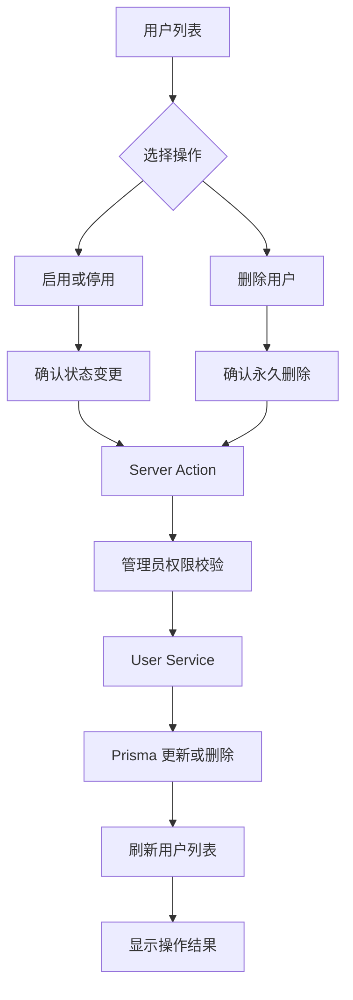

# 第八篇：实现用户启用、停用与删除，完善账号生命周期管理

## 一、本篇要实现什么？

前面几篇，我们已经完成了用户管理的基础功能：

- 用户列表与分页查询
- 新增用户
- 编辑用户资料
- 管理员重置密码

但一个完整的用户管理模块，还需要解决另外三个问题：

1. 用户暂时不允许登录，如何停用账号？
2. 用户重新获得使用权限，如何启用账号？
3. 用户不再需要，如何删除账号？

本篇就围绕这三个功能展开。

最终，我们希望在用户列表的操作列中，实现：

| 操作 | 业务含义 |
|---|---|
| 启用 | 将停用账号恢复为正常状态 |
| 停用 | 禁止账号继续使用系统 |
| 删除 | 从数据库中永久删除用户记录 |

这里先明确一个设计选择：

**启用和停用属于状态变更，删除属于数据删除，两者不是同一类操作。**

启用、停用可以反复切换，而删除是不可逆操作，因此删除必须增加二次确认。

## 二、先看当前数据库模型

打开：

`prisma/schema.prisma`

当前 User 模型已经有状态字段：

```prisma
enum UserStatus {
  ACTIVE
  DISABLED
}

model User {
  id           String   @id @default(uuid())
  username     String   @unique
  passwordHash String
  phone        String?
  status       UserStatus @default(ACTIVE)
  createdAt    DateTime @default(now())
  updatedAt    DateTime @updatedAt
}
```

其中：

```prisma
status UserStatus @default(ACTIVE)
```

表示新建用户默认处于启用状态。

两个枚举值分别表示：

- `ACTIVE`：账号启用。
- `DISABLED`：账号停用。

因此，本篇不需要增加字段，也不需要执行数据库迁移。

### 为什么不直接删除用户状态字段？

因为用户是否存在，与用户是否可以使用系统，是两个不同的问题。

例如：

- 员工离职，但历史业务数据仍然需要保留。
- 合作方暂时停止合作，未来可能恢复。
- 用户违反使用规则，需要临时冻结账号。

这些场景都不应该直接删除用户。

所以，启用和停用应该通过状态字段完成。

### 本篇采用什么删除策略？

当前 User 模型还没有关联课程、订单、教学记录等业务数据，因此本篇采用物理删除：

```ts
db.user.delete({
  where: { id },
});
```

这意味着数据库记录会被真正删除。

等后续用户与课程、教师、订单等业务数据建立关联后，就需要重新评估删除策略。对于有历史业务记录的用户，通常应该采用停用或软删除，而不是直接删除。

## 三、梳理项目结构

继续沿用现有用户模块：

```text
features/users/
├── actions.ts
├── schemas.ts
├── service.ts
├── service.test.ts
├── constants.ts
└── components/
    ├── user-list.tsx
    ├── user-reset-password-dialog.tsx
    └── user-account-actions.tsx
```

本篇新增：

`features/users/components/user-account-actions.tsx`

它负责用户启用、停用和删除的交互。

其他文件职责：

| 文件 | 本篇改动 |
|---|---|
| `service.ts` | 增加状态更新和用户删除方法 |
| `actions.ts` | 增加启用、停用、删除 Server Action |
| `user-list.tsx` | 增加操作入口和成功提示 |
| `user-account-actions.tsx` | 实现确认弹窗和操作按钮 |
| `service.test.ts` | 测试状态更新和删除逻辑 |

整体流程：



## 四、先生成确认弹窗组件

本篇需要使用 AlertDialog。

普通 Dialog 更适合展示表单、编辑资料等交互；AlertDialog 更适合执行具有风险的操作，例如删除数据。

当前仓库尚未生成 AlertDialog 组件，先执行：

```bash
pnpm dlx shadcn@latest add alert-dialog
```

生成后会得到：

`components/ui/alert-dialog.tsx`

它包含：

- `AlertDialog`
- `AlertDialogTrigger`
- `AlertDialogContent`
- `AlertDialogHeader`
- `AlertDialogTitle`
- `AlertDialogDescription`
- `AlertDialogFooter`
- `AlertDialogCancel`
- `AlertDialogAction`

本篇使用它实现二次确认。

## 五、实现 Service 层

打开：

`features/users/service.ts`

我们需要增加两个方法：

- `setUserStatus`：修改用户状态。
- `deleteUser`：删除用户。

### 1. 实现用户状态修改

先导入 UserStatus 类型：

```ts
import type { UserStatus } from "@/app/generated/prisma/client";
```

增加结果类型：

```ts
type UserOperationResult =
  | {
      success: true;
    }
  | {
      success: false;
      code: "NOT_FOUND";
      message: string;
    };
```

然后实现状态修改：

```ts
export async function setUserStatus(
  id: string,
  status: UserStatus
): Promise<UserOperationResult> {
  try {
    await db.user.update({
      where: { id },
      data: { status },
      select: { id: true },
    });

    return {
      success: true,
    };
  } catch (error) {
    const code =
      typeof error === "object" &&
      error !== null &&
      "code" in error
        ? error.code
        : undefined;

    if (code === "P2025") {
      return {
        success: false,
        code: "NOT_FOUND",
        message: "用户不存在或已被删除",
      };
    }

    throw error;
  }
}
```

这段代码非常简单。

核心就是：

```ts
data: { status }
```

管理员传入 `ACTIVE`，用户就变为启用状态；传入 `DISABLED`，用户就变为停用状态。

为什么不在这里分别写两个方法？

因为启用和停用本质上都是修改同一个字段，只是目标状态不同。

将它们统一为 `setUserStatus`，可以避免重复代码。

另外，数据库更新使用 `where: { id }`。如果用户已经被删除，Prisma 会返回 `P2025`，我们将它转换为明确的业务结果。

### 2. 实现用户删除

继续在 `service.ts` 中增加：

```ts
export async function deleteUser(
  id: string
): Promise<UserOperationResult> {
  try {
    await db.user.delete({
      where: { id },
      select: { id: true },
    });

    return {
      success: true,
    };
  } catch (error) {
    const code =
      typeof error === "object" &&
      error !== null &&
      "code" in error
        ? error.code
        : undefined;

    if (code === "P2025") {
      return {
        success: false,
        code: "NOT_FOUND",
        message: "用户不存在或已被删除",
      };
    }

    throw error;
  }
}
```

这里与状态修改的区别是：

```ts
db.user.delete()
```

这是真正删除数据库记录。

需要特别注意：如果以后 User 与其他业务表建立了外键关系，删除操作可能触发 Prisma 的关联约束错误，例如 `P2003`。

不能为了让删除成功就随意级联删除关联数据。

对于用户历史数据，应该优先考虑保留记录，而不是为了删除账号把业务数据一并清除。

## 六、实现 Server Actions

打开：

`features/users/actions.ts`

现有文件已经包含：

- `createUserAction`
- `updateUserAction`
- `resetUserPasswordAction`

本篇继续增加两个 Action。

先增加 UserStatus 类型和 Service 导入：

```ts
import type { UserStatus } from "@/app/generated/prisma/client";

import {
  createUser,
  updateUser,
  resetUserPassword,
  setUserStatus,
  deleteUser,
} from "./service";
```

### 1. 用户启用和停用 Action

增加：

```ts
export async function setUserStatusAction(
  id: string,
  status: UserStatus
) {
  await requireUserAdmin();

  if (status !== "ACTIVE" && status !== "DISABLED") {
    throw new Error("无效的用户状态");
  }

  const result = await setUserStatus(id, status);

  if (!result.success) {
    redirect("/admin/users?error=user-not-found");
  }

  revalidatePath("/admin/users");

  redirect("/admin/users?statusChanged=1");
}
```

这里有几个关键点。

**第一，服务端再次校验目标状态。**

虽然 TypeScript 已经限制了 `UserStatus` 类型，但运行时传入的数据仍然不能盲目信任。

所以增加：

```ts
if (status !== "ACTIVE" && status !== "DISABLED") {
  throw new Error("无效的用户状态");
}
```

**第二，必须校验管理员权限。**

```ts
await requireUserAdmin();
```

不能仅仅依赖前端隐藏按钮。

**第三，操作成功后刷新用户列表。**

```ts
revalidatePath("/admin/users");
```

这样返回列表时就能看到最新状态。

### 2. 用户删除 Action

继续增加：

```ts
export async function deleteUserAction(id: string) {
  await requireUserAdmin();

  const result = await deleteUser(id);

  if (!result.success) {
    redirect("/admin/users?error=user-not-found");
  }

  revalidatePath("/admin/users");

  redirect("/admin/users?deleted=1");
}
```

删除 Action 不需要接收表单字段。

因为删除操作只需要用户 ID。

注意：这里的 ID 仍然只是定位目标记录的参数，不代表调用者有权删除该用户。真正的权限检查必须在服务端完成。

## 七、实现用户操作组件

新增：

`features/users/components/user-account-actions.tsx`

这个组件负责两个部分：

1. 根据当前状态显示启用或停用按钮。
2. 点击删除后弹出二次确认框。

完整代码：

```tsx
"use client";

import { Button } from "@/components/ui/button";

import {
  AlertDialog,
  AlertDialogAction,
  AlertDialogCancel,
  AlertDialogContent,
  AlertDialogDescription,
  AlertDialogFooter,
  AlertDialogHeader,
  AlertDialogTitle,
  AlertDialogTrigger,
} from "@/components/ui/alert-dialog";

import { setUserStatusAction, deleteUserAction } from "../actions";

type UserAccountActionsProps = {
  user: {
    id: string;
    username: string;
    status: "ACTIVE" | "DISABLED";
  };
};

export function UserAccountActions({
  user,
}: UserAccountActionsProps) {
  const nextStatus =
    user.status === "ACTIVE" ? "DISABLED" : "ACTIVE";

  const statusAction = setUserStatusAction.bind(
    null,
    user.id,
    nextStatus
  );

  const deleteAction = deleteUserAction.bind(
    null,
    user.id
  );

  const isActive = user.status === "ACTIVE";

  return (
    <div className="flex justify-end gap-2">
      <form action={statusAction}>
        <Button
          type="submit"
          size="sm"
          variant="outline"
        >
          {isActive ? "停用" : "启用"}
        </Button>
      </form>

      <AlertDialog>
        <AlertDialogTrigger
          render={
            <Button
              size="sm"
              variant="destructive"
            />
          }
        >
          删除
        </AlertDialogTrigger>

        <AlertDialogContent>
          <AlertDialogHeader>
            <AlertDialogTitle>
              确认删除用户？
            </AlertDialogTitle>

            <AlertDialogDescription>
              即将永久删除用户「{user.username}」。
              删除后无法恢复，请确认该用户没有需要保留的业务数据。
            </AlertDialogDescription>
          </AlertDialogHeader>

          <AlertDialogFooter>
            <AlertDialogCancel>
              取消
            </AlertDialogCancel>

            <form action={deleteAction}>
              <AlertDialogAction
                type="submit"
                variant="destructive"
              >
                确认删除
              </AlertDialogAction>
            </form>
          </AlertDialogFooter>
        </AlertDialogContent>
      </AlertDialog>
    </div>
  );
}
```

### 为什么启用和停用不需要确认弹窗？

启用和停用是可逆操作，可以直接点击完成。

删除则不同，一旦删除就可能丢失数据，因此必须增加确认步骤。

如果未来系统的账号停用会触发复杂后果，例如终止正在进行的业务流程，也可以为停用增加确认弹窗。

### 为什么使用 Server Action 作为 form action？

```tsx
<form action={statusAction}>
```

这是 React 19 与 Next.js Server Actions 支持的表单提交方式。

它不需要额外编写 API Route，也不需要在客户端使用 fetch。

按钮提交后，服务端完成权限检查、业务处理和数据库更新。

### 为什么删除操作要再次确认？

```tsx
<AlertDialogTitle>
  确认删除用户？
</AlertDialogTitle>
```

删除是破坏性操作。

确认弹窗不是为了增加操作步骤，而是让管理员明确知道自己正在删除哪一个用户。

## 八、改造用户列表

打开：

`features/users/components/user-list.tsx`

首先导入：

```tsx
import { UserAccountActions } from "./user-account-actions";
```

当前列表已经有编辑和重置密码按钮。

找到操作列：

```tsx
<TableCell className="text-right">
  <div className="flex justify-end gap-2">
    <Link
      href={`/admin/users/${user.id}/edit`}
      className={buttonVariants({
        variant: "outline",
        size: "sm",
      })}
    >
      编辑
    </Link>

    <UserResetPasswordDialog user={user} />
  </div>
</TableCell>
```

将它替换为：

```tsx
<TableCell className="text-right">
  <div className="flex flex-wrap justify-end gap-2">
    <Link
      href={`/admin/users/${user.id}/edit`}
      className={buttonVariants({
        variant: "outline",
        size: "sm",
      })}
    >
      编辑
    </Link>

    <UserResetPasswordDialog user={user} />

    <UserAccountActions user={user} />
  </div>
</TableCell>
```

这样，每个用户都拥有完整的操作入口：

- 编辑
- 重置密码
- 启用或停用
- 删除

注意，当前 `getUserList` 已经查询了 `status` 字段，所以不需要增加数据库查询字段。

## 九、增加操作结果提示

继续修改：

`features/users/components/user-list.tsx`

在读取 `searchParams` 的位置增加：

```tsx
const statusChanged = params.statusChanged === "1";
const deleted = params.deleted === "1";
const error = params.error;
```

然后在列表顶部增加：

```tsx
{statusChanged && (
  <p role="status" className="text-sm text-green-600">
    用户状态修改成功
  </p>
)}

{deleted && (
  <p role="status" className="text-sm text-green-600">
    用户删除成功
  </p>
)}

{error === "user-not-found" && (
  <p role="alert" className="text-sm text-destructive">
    用户不存在或已被删除，请刷新列表后重试
  </p>
)}
```

到这里，操作成功和失败都有了明确反馈。

## 十、完善 Service 测试

打开：

`features/users/service.test.ts`

当前测试文件已经 Mock 了：

```ts
const {
  findMany,
  count,
  create,
  update,
  findUnique,
  hashPassword,
} = vi.hoisted(() => ({
  findMany: vi.fn(),
  count: vi.fn(),
  create: vi.fn(),
  update: vi.fn(),
  findUnique: vi.fn(),
  hashPassword: vi.fn(),
}));
```

本篇只需要再增加一个 `delete` Mock。

调整为：

```ts
const {
  findMany,
  count,
  create,
  update,
  findUnique,
  deleteUserMock,
  hashPassword,
} = vi.hoisted(() => ({
  findMany: vi.fn(),
  count: vi.fn(),
  create: vi.fn(),
  update: vi.fn(),
  findUnique: vi.fn(),
  deleteUserMock: vi.fn(),
  hashPassword: vi.fn(),
}));
```

同时调整数据库 Mock：

```ts
vi.mock("@/lib/db", () => ({
  db: {
    user: {
      findMany,
      count,
      create,
      update,
      findUnique,
      delete: deleteUserMock,
    },
  },
}));
```

在 Service 导入中增加：

```ts
import {
  createUser,
  getUserById,
  getUserList,
  resetUserPassword,
  updateUser,
  setUserStatus,
  deleteUser,
} from "./service";
```

### 1. 测试用户状态修改

增加：

```ts
describe("setUserStatus", () => {
  beforeEach(() => {
    vi.clearAllMocks();

    update.mockResolvedValue({
      id: "user-1",
    });
  });

  it("应将用户状态修改为 DISABLED", async () => {
    const result = await setUserStatus(
      "user-1",
      "DISABLED"
    );

    expect(update).toHaveBeenCalledWith({
      where: {
        id: "user-1",
      },
      data: {
        status: "DISABLED",
      },
      select: {
        id: true,
      },
    });

    expect(result).toEqual({
      success: true,
    });
  });

  it("应将用户状态修改为 ACTIVE", async () => {
    const result = await setUserStatus(
      "user-1",
      "ACTIVE"
    );

    expect(update).toHaveBeenCalledWith({
      where: {
        id: "user-1",
      },
      data: {
        status: "ACTIVE",
      },
      select: {
        id: true,
      },
    });

    expect(result).toEqual({
      success: true,
    });
  });

  it("用户不存在时应返回 NOT_FOUND", async () => {
    update.mockRejectedValue({
      code: "P2025",
    });

    const result = await setUserStatus(
      "missing-user",
      "DISABLED"
    );

    expect(result).toEqual({
      success: false,
      code: "NOT_FOUND",
      message: "用户不存在或已被删除",
    });
  });

  it("其他数据库异常应继续抛出", async () => {
    const error = new Error("connection lost");

    update.mockRejectedValue(error);

    await expect(
      setUserStatus("user-1", "DISABLED")
    ).rejects.toBe(error);
  });
});
```

### 2. 测试用户删除

增加：

```ts
describe("deleteUser", () => {
  beforeEach(() => {
    vi.clearAllMocks();

    deleteUserMock.mockResolvedValue({
      id: "user-1",
    });
  });

  it("应成功删除指定用户", async () => {
    const result = await deleteUser("user-1");

    expect(deleteUserMock).toHaveBeenCalledWith({
      where: {
        id: "user-1",
      },
      select: {
        id: true,
      },
    });

    expect(result).toEqual({
      success: true,
    });
  });

  it("用户不存在时应返回 NOT_FOUND", async () => {
    deleteUserMock.mockRejectedValue({
      code: "P2025",
    });

    const result = await deleteUser("missing-user");

    expect(result).toEqual({
      success: false,
      code: "NOT_FOUND",
      message: "用户不存在或已被删除",
    });
  });

  it("其他数据库异常应继续抛出", async () => {
    const error = new Error("connection lost");

    deleteUserMock.mockRejectedValue(error);

    await expect(
      deleteUser("user-1")
    ).rejects.toBe(error);
  });
});
```

运行测试：

```bash
pnpm test
```

这里需要注意，`deleteUserMock` 只是测试文件中的 Mock 函数名称，真正的数据库方法仍然是 `db.user.delete()`。

## 十一、浏览器验证

启动项目：

```bash
pnpm dev
```

打开：

`/admin/users`

依次验证：

### 测试一：停用用户

1. 找到一个启用状态的用户。
2. 点击“停用”。
3. 页面返回用户列表。
4. 检查状态是否变成“停用”。
5. 检查是否出现成功提示。

### 测试二：启用用户

1. 找到一个停用状态的用户。
2. 点击“启用”。
3. 检查状态是否变成“启用”。

### 测试三：删除用户

1. 找到一个专门用于测试的用户。
2. 点击“删除”。
3. 检查是否弹出二次确认框。
4. 点击取消，确认用户仍然存在。
5. 再次点击删除。
6. 点击确认删除。
7. 检查用户是否从列表中消失。

### 测试四：数据库验证

使用 pgAdmin 查询：

```sql
SELECT
  id,
  username,
  status,
  created_at
FROM "User"
ORDER BY "createdAt" DESC;
```

检查：

- 停用用户的状态为 `DISABLED`。
- 启用用户的状态为 `ACTIVE`。
- 删除的用户已经不在数据库中。

## 十二、还需要考虑的三个问题

本篇虽然完成了三个操作，但从真实系统的角度看，还有几个问题需要提前明确。

### 1. 停用账号不等于已经禁止登录

当前我们只是修改了：

```ts
status = "DISABLED"
```

真正的登录认证还没有接入。

因此，未来实现登录功能时，必须增加状态校验：

```ts
if (user.status !== "ACTIVE") {
  throw new Error("账号已停用，无法登录");
}
```

否则，即使管理员已经停用了用户，登录流程仍然可能允许该用户进入系统。

**状态字段只有被业务流程真正使用，才有实际意义。**

### 2. 用户删除不能破坏历史业务数据

现在 User 模型没有业务关联，物理删除可以正常执行。

但未来可能出现这样的关系：

```text
User
 ├── Teacher
 ├── Student
 ├── Course
 ├── Order
 ├── Payment
 └── TeachingRecord
```

这时直接删除 User，就可能影响历史记录的完整性。

对于真实业务系统，更合理的设计通常是：

- 离职教师：停用账号，保留历史授课记录。
- 退费或结束合作的客户：保留订单和财务流水。
- 不再使用的账号：停用或软删除。
- 测试账号、误创建且没有业务关联的账号：允许物理删除。

删除规则应该由业务关系决定，而不是只看能不能执行 SQL。

### 3. 管理员不能随意删除自己

目前项目还没有真正的认证和管理员身份体系，所以无法可靠判断当前操作人是不是正在删除自己的账号。

接入认证后，需要在服务端增加约束：

- 不允许管理员删除当前登录账号。
- 不允许管理员停用自己的账号。
- 不能让最后一个管理员失去管理权限。
- 对敏感操作记录操作人、操作时间和操作对象。

这些规则不能只在前端判断。

---

## 本篇小结

本篇完成了用户管理中的三个功能：

1. **启用用户**：将 `status` 设置为 `ACTIVE`。
2. **停用用户**：将 `status` 设置为 `DISABLED`。
3. **删除用户**：通过 Prisma 物理删除用户记录，并增加二次确认。

到这里，用户管理模块已经形成了比较完整的功能闭环：

```text
用户管理
  ├── 用户列表
  ├── 新增用户
  ├── 编辑资料
  ├── 重置密码
  ├── 启用账号
  ├── 停用账号
  └── 删除用户
```

但我们还没有真正解决用户管理中最重要的问题：**谁有权执行这些操作？**

目前的 `requireUserAdmin()` 仍然只是开发环境守卫，并不是真正的管理员认证。

下一阶段需要逐步接入登录认证、角色管理和权限控制，让用户管理从“能操作”真正走向“按权限操作”。